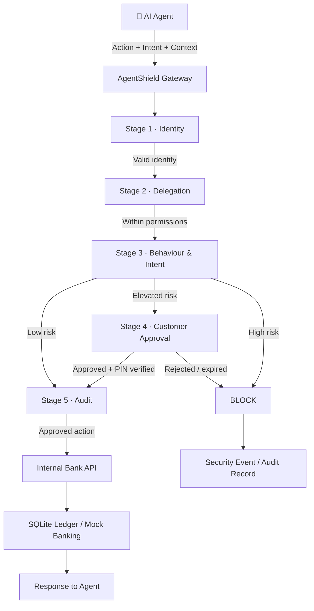
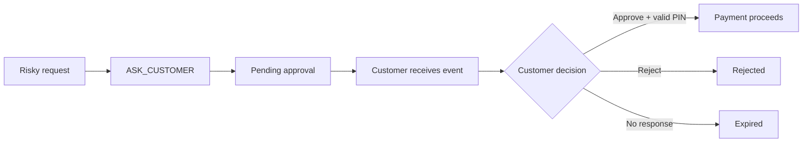

<div align="center">

# 🛡️ AgentShield

### A Zero-Trust Security Gateway for AI Banking Agents

**Let AI agents act. Never let them act unchecked.**

AgentShield sits between autonomous AI agents and banking APIs, validating identity, permissions, behaviour, intent, and risk before a financial action can reach the bank.

<br/>


<br/>

> **An AI agent may be intelligent—but intelligence is not authorization.**  
> AgentShield gives every agent action a security checkpoint before it can touch a simulated banking system.

</div>

---

## ✦ The Problem

AI agents are increasingly capable of performing real-world actions: paying bills, transferring money, managing accounts, and interacting with external tools.

But what happens when an agent:

- Receives malicious instructions hidden inside a webpage or document?
- Uses a stolen delegation token from a different device or IP?
- Attempts an action outside the permissions granted by its user?
- Makes an unusual payment at an unusual time?
- Tries to split transactions to avoid spending limits?
- Replays an old request?
- Bypasses the security layer and calls the banking API directly?

Traditional API authentication alone cannot reliably answer all of these questions.

### AgentShield's approach

Instead of trusting the agent, AgentShield evaluates **every financial action** through a layered security pipeline.

```text
┌──────────────────────┐
│     AI BANKING AGENT │
│  "Pay this electricity│
│       bill"          │
└──────────┬───────────┘
           │
           ▼
┌──────────────────────────────────────────────────────────────┐
│                       AGENTSHIELD                            │
│                                                              │
│  Identity → Delegation → Behaviour → Human Approval → Audit   │
│                                                              │
│                 ALLOW / BLOCK / ASK CUSTOMER                  │
└──────────────────────────────┬───────────────────────────────┘
                               │
                     Only approved actions
                               ▼
                   ┌──────────────────────┐
                   │   MOCK BANK API      │
                   │ Accounts · Payees    │
                   │ Payments · Ledger    │
                   └──────────────────────┘
```

---

## 🚀 What AgentShield Does

| Capability | What it does |
|---|---|
| 🔐 **Identity & Token Binding** | Validates delegation JWTs and binds agent identity to runtime/device/network fingerprints. |
| 🎯 **Scoped Delegation** | Enforces user-granted actions, categories, payee permissions, transaction limits, and spending limits. |
| 🧠 **Behavioural Risk Detection** | Looks for unusual amounts, unusual hours, new payees, rapid requests, structuring, and changes in action patterns. |
| 🕵️ **Prompt-Injection Detection** | Examines request provenance and suspicious context snippets for untrusted instructions. |
| 👤 **Human-in-the-Loop** | Sends risky actions to the customer for approval instead of blindly allowing or automatically rejecting every unusual request. |
| 🔔 **Live Security Events** | Streams customer approval and security events using Server-Sent Events (SSE). |
| 🔗 **Tamper-Evident Audit Trail** | Hash-chains audit entries and signs them using HMAC-SHA256 for integrity verification. |
| 🧪 **Attack Lab** | Lets users explore security scenarios and observe gateway decisions. |
| 📊 **Benchmark & Self-Test** | Includes an end-to-end scenario suite and a labelled red-team benchmark. |
| 🧩 **Developer SDK** | Provides a TypeScript client for sending agent actions through the gateway. |

---

## 🏗️ System Architecture

### The complete request journey



### Security boundary

The gateway is designed as the enforcement boundary between agents and the banking service.

- Agents submit actions to `/api/gateway/*`.
- The bank API requires an internal shared-secret header.
- Gateway-to-bank requests are authenticated using `x-bank-internal-secret`.
- Agents should not be able to call protected bank endpoints directly.
- The gateway makes the decision before a payment is settled.

> This repository implements a simulated banking environment. It is a security prototype/demo, not a production banking integration or independent security certification.

---

## 🔬 The 5-Stage Security Pipeline

Each supported agent action is processed sequentially.

### Stage 01 — Identity & Token Binding
**Question: Is this request coming from the authorized agent?**

- HS256 delegation JWT validation
- Token ID (`jti`) and expiration checks
- Agent status validation
- Runtime/device/network fingerprint binding
- Timestamp validation with a 60-second window
- Unique nonce validation to prevent replay
- Foreign-fingerprint token replay detection and token suspension

**Result:** Invalid, expired, replayed, or mismatched requests are rejected before policy evaluation.

---

### Stage 02 — Scoped Delegation Engine
**Question: Was this action actually permitted by the user?**

The gateway applies default-deny authorization against the customer's active grant.

It checks:

- Allowed actions
- Allowed spending categories
- Optional payee allowlist
- Per-transaction spending cap
- Daily cumulative spending cap
- Monthly cumulative spending cap
- Grant expiry
- Revocation status

Spending totals are computed using the SQLite transaction ledger.

**Result:** A valid agent identity is not enough. The requested action must remain within the delegation.

---

### Stage 03 — Behavioural Risk & Intent Analysis
**Question: Does this request look suspicious or inconsistent with the agent's normal behaviour?**

AgentShield compares requests against a rolling per-agent behavioural baseline and evaluates risk signals including:

- Unusual payment amount
- Amount deviation / Z-score
- Unusual transaction hour
- New payee
- Request velocity and bursts
- Structuring / smurfing near transaction ceilings
- Sudden changes in action mix
- Mismatch between declared intent and requested action
- Context provenance
- Prompt-injection indicators in untrusted snippets

The baseline is updated only after allowed or customer-approved requests—not simply because an attacker submitted a request.

**Result:** Behavioural signals can increase risk and trigger blocking or customer approval.

---

### Stage 04 — Human-in-the-Loop Approval
**Question: Should the customer make the final decision?**

Requests requiring additional verification can enter an approval workflow.



Implemented workflow includes:

- Pending approval requests
- SSE notifications through `/api/events/stream`
- Long-polling request status
- Customer step-up PIN verification
- PIN lockout after five incorrect attempts
- Approval re-validation before settlement
- Idempotent one-time settlement
- Explicit expiration handling
- Optional “Always trust this payee” behaviour for future payments

**Result:** Risky actions are not automatically treated as safe merely because the agent requested them.

---

### Stage 05 — Tamper-Evident Audit
**Question: Can the security decision and its history be verified?**

Audit entries are linked together using a hash chain:

```text
Entry 001                  Entry 002                  Entry 003
┌──────────────┐          ┌──────────────┐          ┌──────────────┐
│ entry_hash  │─────────▶│ prev_hash    │          │ prev_hash    │
│              │          │ entry_hash   │─────────▶│ entry_hash   │
└──────────────┘          └──────────────┘          └──────────────┘
```

The implementation uses:

- SHA-256 hash chaining
- Canonical JSON representation
- HMAC-SHA256 signatures
- Append-oriented audit records
- Live chain verification
- A demo tamper simulation

Verification endpoints:

```text
GET  /api/audit/verify
POST /api/audit/simulate-tamper
```

The tamper simulation is a demo feature and is not available outside demo mode.

---

## 🖥️ Explore the Application

AgentShield contains multiple interfaces designed to demonstrate different parts of the security system.

| Workspace | What you can explore |
|---|---|
| **Landing Page** | Project introduction, security concept, visual entry point, and navigation. |
| **Customer App** | Customer account overview, transactions, agents, delegation grants, approval requests, and security-related actions. |
| **Bank Admin Console** | Administrative overview, agent status, policy/risk configuration, and system monitoring. |
| **Attack Lab** | Security scenarios, simulated agent requests, attack demonstrations, and gateway verdicts. |
| **Audit Explorer** | Security events, audit records, and integrity verification. |
| **Documentation / SDK** | Threat coverage, integration examples, cURL, TypeScript, Python, and OpenAPI information. |

The application also includes UI features such as animated visual elements, sound controls, theme/card styling controls, demo role switching, and demo reset functionality.

---

## 🧪 Attack Lab

The Attack Lab is a controlled environment for exploring how different requests are evaluated.

### Scenarios represented in the project

- Direct prompt injection
- Indirect prompt injection
- Paraphrased injection
- Multilingual / Hinglish / Bengali attack content
- Encoded or obfuscated payloads
- Multi-step escalation
- Transaction structuring / smurfing
- Off-hours anomalies
- New-payee anomalies
- Replay and token theft
- Scope violations

### Typical demonstration

```text
1. Select a simulated attack scenario
2. Send the agent request
3. Observe the gateway's security stages
4. Inspect the risk score and verdict
5. View whether the request was allowed, blocked, or escalated
6. Explore the resulting audit event
```

The project self-test also includes a legitimate request, so the demonstration is not simply about blocking everything.

---

## 📈 Benchmark Results

The repository includes a benchmark report generated by executing labelled samples through `executeGatewayPipeline()`.

> **Important:** These results come from an internal, template-generated red-team dataset. They are not an independent third-party security evaluation and should not be interpreted as real-world detection guarantees.

### Reported results

| Metric | Result |
|---|---:|
| Total benchmark samples | **272** |
| Attack samples | 164 |
| Benign samples | 108 |
| Attack stopped (`BLOCK` or `ASK_CUSTOMER`) | **158 / 164 · 96.3%** |
| Benign hard-block rate | **0 / 108 · 0%** |
| Benign total alert rate | **0 / 108 · 0%** |
| Pipeline latency · p50 | 2.28 ms |
| Pipeline latency · p95 | 4.70 ms |
| Pipeline latency · p99 | 8.14 ms |
| Pipeline latency · mean | 2.77 ms |

### Detection results by category

| Attack category | Samples | Stopped | Detection rate |
|---|---:|---:|---:|
| Direct injection | 15 | 15 | 100% |
| Indirect injection | 15 | 15 | 100% |
| Paraphrased injection | 20 | 14 | 70% |
| Multilingual / Hinglish / Bengali | 16 | 16 | 100% |
| Encoded / obfuscated | 18 | 18 | 100% |
| Multi-step escalation | 12 | 12 | 100% |
| Structuring / smurfing | 12 | 12 | 100% |
| Off-hours anomaly | 12 | 12 | 100% |
| New-payee anomaly | 14 | 14 | 100% |
| Replay / token theft | 14 | 14 | 100% |
| Scope violations | 16 | 16 | 100% |

### Understanding the misses

The benchmark report identifies **6 paraphrased-injection samples** that passed the behavioural/rule detection layer. The report marks these as bounded by Stage 2 delegation caps in its test scenarios.

This is an important design principle: **detection is not the only safety layer**. Spending limits and permission scopes can constrain the potential impact even when a detector misses an attack.

See the detailed report:

- [`docs/BENCHMARK.md`](docs/BENCHMARK.md)
- [`docs/benchmark-summary.json`](docs/benchmark-summary.json)

---

## ⚙️ Tech Stack

### Frontend

| Technology | Purpose |
|---|---|
| React 19 | UI framework |
| TypeScript | Type-safe application code |
| Vite | Development server and frontend build |
| Tailwind CSS | Styling |
| Motion | UI animation |
| Three.js | 3D visual components |
| Recharts | Data visualization |
| Lucide React | Icons |

### Backend

| Technology | Purpose |
|---|---|
| Node.js 22 | Runtime |
| Express 4 | HTTP API |
| TypeScript / TSX | Server implementation |
| SQLite | Persistent local database |
| `better-sqlite3` | SQLite driver |
| `jose` | JWT-related cryptographic functionality |
| Zod | Request/data validation |
| Server-Sent Events | Live event delivery |

### Security & Testing

- HS256 JWT delegation tokens
- SHA-256 fingerprints and audit hashing
- HMAC-SHA256 audit signatures
- Nonce and timestamp replay controls
- PIN-based approval step-up
- Idempotency controls
- Vitest
- Supertest
- Internal benchmark and self-test scripts

---

## 🗂️ Project Structure

```text
AgentShield/
│
├── src/                            # Frontend application
│   ├── App.tsx                     # App shell, routing & session UI
│   ├── main.tsx                    # Frontend entry point
│   ├── index.css                   # Global styles
│   │
│   ├── components/
│   │   ├── LandingPage.tsx          # Project landing page
│   │   ├── CustomerApp.tsx          # Customer banking interface
│   │   ├── BankConsole.tsx          # Bank administration interface
│   │   ├── AttackLab.tsx            # Security scenario laboratory
│   │   ├── AuditExplorer.tsx        # Audit and integrity explorer
│   │   ├── DocsPage.tsx             # Documentation / SDK page
│   │   ├── ThreeShieldCanvas.tsx    # Three.js shield visual
│   │   ├── CrystalizedBall.tsx      # Decorative visual component
│   │   ├── DitherVeilBackground.tsx # Background effect
│   │   └── FluidCursorOverlay.tsx   # Cursor interaction effect
│   │
│   ├── sdk/
│   │   └── agentshield-sdk.ts       # TypeScript client
│   │
│   └── utils/
│       ├── soundEffects.ts          # UI sound helpers
│       └── pdfReceipt.ts            # Receipt PDF utility
│
├── server/                          # Backend
│   ├── app.ts                       # Express application setup
│   ├── auth.ts                      # Authentication/session logic
│   ├── config.ts                    # Environment/configuration
│   ├── types.ts                     # Shared server types
│   ├── time.ts                      # Time utilities
│   ├── money.ts                     # Money-related helpers
│   ├── sse.ts                       # Server-Sent Events
│   │
│   ├── gateway/
│   │   ├── pipeline.ts              # Main security pipeline
│   │   ├── stage1_identity.ts        # Identity & token binding
│   │   ├── stage2_delegation.ts      # Grant and spending policy
│   │   ├── stage3_behavior.ts        # Behavioural risk analysis
│   │   ├── stage4_escalation.ts      # Customer approval
│   │   ├── stage5_audit.ts           # Audit integrity
│   │   ├── crypto.ts                 # Cryptographic helpers
│   │   ├── llmJudge.ts               # Optional LLM judging logic
│   │   ├── liveAgent.ts              # Live BillPay agent flow
│   │   ├── benchmark.ts              # Benchmark scenarios
│   │   └── selftest.ts               # Pipeline self-test
│   │
│   ├── bank/
│   │   └── bankService.ts             # Mock banking operations
│   │
│   ├── db/
│   │   ├── database.ts                # SQLite database
│   │   └── seed.ts                    # Demo data
│   │
│   └── routes/
│       ├── appRoutes.ts                # App, auth, customer/admin/audit APIs
│       ├── gatewayRoutes.ts            # Gateway endpoints
│       └── bankRoutes.ts               # Protected bank endpoints
│
├── scripts/
│   ├── selftest.ts                    # Self-test runner
│   ├── benchmark.ts                   # Benchmark runner
│   └── anchor-audit.ts                # Audit anchoring utility
│
├── tests/                              # Automated test suites
├── docs/
│   ├── BENCHMARK.md                   # Detailed benchmark report
│   └── benchmark-summary.json          # Benchmark data
│
├── public/                              # Static assets
├── server.ts                            # Server entry point
├── package.json
├── vite.config.ts
├── .env.example
├── THREAT_MODEL.md
├── DEMO_SCRIPT.md
└── README.md
```

---

## 🛠️ Getting Started

### Prerequisites

- **Node.js 22 LTS**
- npm
- Git

> `better-sqlite3` is a native dependency. Node 22 is the project's specified runtime range (`>=22 <23`). If installation fails on Windows, see the troubleshooting section.

### 1. Clone the repository

```bash
git clone https://github.com/<YOUR_USERNAME>/<YOUR_REPOSITORY>.git
cd AgentShield
```

Replace the repository URL with your actual GitHub repository URL.

### 2. Install dependencies

```bash
npm install
```

### 3. Configure environment variables

Copy the example file:

**Windows PowerShell**
```powershell
Copy-Item .env.example .env
```

**macOS / Linux**
```bash
cp .env.example .env
```

For local demo mode, the project is configured to use development defaults. Review `.env.example` and `server/config.ts` before changing configuration.

### 4. Start the application

```bash
npm run dev
```

Open:

**http://localhost:3000**

### 5. Explore the demo

Navigate through the application:

```text
Landing Page
   ├── Customer App
   ├── Bank Admin Console
   ├── Attack Lab
   ├── Audit Explorer
   └── Documentation / SDK
```

Demo-mode features include role switching and demo reset. These shortcuts are intended for demonstration and are disabled in production mode.

---

## 🔑 Demo Accounts

The repository seeds demo users and banking data.

| Role | Email | Password |
|---|---|---|
| Customer | `arjun.sen@example.in` | `arjun2026` |
| Bank Admin | `admin@agentshield.bank` | `admin2026` |

**Customer step-up PIN:** `2026`

Demo data includes:

- Indian Rupee account balances
- CESC Kolkata
- Jio Fiber
- KMC Water Tax
- Bengal Gas Co.
- Airtel Postpaid
- Historical transactions
- Three demo agents: BillPay Autopilot, SpendTracker Insights, and ShopBuddy AI

> These are seeded demo credentials. Never use them in a real deployment.

---

## 🧑‍💻 Developer Commands

| Command | Description |
|---|---|
| `npm run dev` | Start the application in development mode |
| `npm start` | Start the server |
| `npm run build` | Build the frontend |
| `npm run preview` | Preview the Vite build |
| `npm test` | Run the automated test suite |
| `npm run lint` | Run TypeScript type checking |
| `npm run selftest` | Run the gateway self-test |
| `npm run benchmark` | Execute the benchmark dataset |
| `npm run audit:anchor` | Run the audit anchoring utility |
| `npm run clean` | Remove build outputs |

### Run tests

```bash
npm test
```

The repository includes test suites for:

- Pipeline behaviour
- Identity and security controls
- Delegation and policy checks
- Approval and PIN workflows
- API routes
- Authentication and ownership
- Token issuance
- Event scoping
- Production configuration
- Idempotency
- Audit-chain hardening

### Run the self-test

```bash
npm run selftest
```

The self-test runs **14 scenarios**: one legitimate ALLOW scenario and 13 attack/escalation scenarios. The Attack Lab also presents these scenarios, with a separate Live BillPay agent run.

---

## 🔌 API Overview

### Gateway

| Endpoint | Purpose |
|---|---|
| `POST /api/gateway/execute` | Execute an agent action through the security pipeline |
| `POST /api/gateway/tokens` | Issue a delegation token for an authorized grant |
| `GET /api/gateway/requests/:id` | Retrieve or wait for an approval request |
| `POST /api/gateway/scenario` | Demo scenario endpoint |
| `POST /api/gateway/live-agent` | Demo Live BillPay agent |

### Banking API

| Endpoint | Purpose |
|---|---|
| `GET /api/bank/accounts` | Retrieve account information |
| `GET /api/bank/payees` | Retrieve payees |
| `GET /api/bank/transactions` | Retrieve transaction history |
| `POST /api/bank/execute` | Execute a bank action; protected by the internal gateway secret |

### Customer / Admin / Audit

| Endpoint | Purpose |
|---|---|
| `GET /api/customer/overview` | Customer overview |
| `GET /api/customer/grants` | Customer delegation grants |
| `POST /api/customer/grants/:id/revoke` | Revoke a grant |
| `POST /api/customer/approvals/:id/resolve` | Resolve a customer approval |
| `GET /api/console/overview` | Bank admin overview |
| `POST /api/console/agents/:id/status` | Update agent status |
| `GET /api/audit/logs` | Retrieve authorized audit records |
| `GET /api/audit/verify` | Verify audit-chain integrity |
| `POST /api/audit/simulate-tamper` | Demo tamper simulation |
| `GET /api/events/stream` | Server-Sent Events stream |
| `GET /api/docs` | OpenAPI specification |
| `GET /api/selftest` | HTTP self-test endpoint |

Access restrictions apply to these endpoints; demo-only endpoints are not available in production mode.

---

## 📦 TypeScript SDK

AgentShield includes a lightweight TypeScript client at:

```text
src/sdk/agentshield-sdk.ts
```

### Example

```typescript
import { AgentShieldClient } from "./sdk/agentshield-sdk";

const shield = new AgentShieldClient({
  baseUrl: "http://localhost:3000",
  token: process.env.AGENT_DELEGATION_JWT!,
  agentRuntimeId: "rt_billpay_prod_kol_01",
  ip: "103.21.58.14",
  asn: "AS9498",
});

const decision = await shield.execute({
  action: "pay_bill",
  params: {
    payeeId: "payee_cesc",
    category: "electricity",
    amount: 1840,
  },
  intent: "Pay monthly CESC Kolkata electricity bill",
  provenance: "user_instruction",
});

console.log(decision);
```

### Supported actions

```typescript
type AgentAction =
  | "check_balance"
  | "pay_bill"
  | "transfer"
  | "add_payee";
```

### Supported provenance values

```typescript
type ContextProvenance =
  | "user_instruction"
  | "tool_output"
  | "untrusted_document"
  | "web_content";
```

The SDK creates a nonce and timestamp and sends the action, intent, provenance, and fingerprint information to the gateway.

---

## 🔐 Environment Configuration

See [`.env.example`](.env.example) for the complete list.

For production mode, the server requires separate secrets of at least 24 characters:

| Variable | Purpose |
|---|---|
| `AGENTSHIELD_JWT_SECRET` | Signs/validates delegation JWTs |
| `AGENTSHIELD_AUDIT_HMAC_KEY` | Signs audit entries |
| `BANK_INTERNAL_SECRET` | Authenticates gateway-to-bank requests |
| `SESSION_SECRET` | Signs session cookies |

These secrets must be **different from each other**.

Optional configuration includes:

| Variable | Purpose |
|---|---|
| `DEMO_MODE` | Enables demo shortcuts; defaults off in production |
| `TRUST_CLIENT_FINGERPRINT` | Controls whether declared client fingerprints are trusted |
| `TRUST_PROXY` | Configures trusted proxy hops |
| `ANTHROPIC_API_KEY` | Enables the Live BillPay AI agent; without it, a deterministic scripted agent is used |

### Production startup

```bash
npm run build
NODE_ENV=production npm start
```

Configure the required secrets before starting the application in production.

---

## 🐳 Docker

A Dockerfile is included in the repository, but Docker was **not verified** in the environment used to prepare this project documentation.

Build:

```bash
docker build -t agentshield .
```

Run:

```bash
docker run -p 3000:3000 \
  -e AGENTSHIELD_JWT_SECRET="your-unique-secret-24-characters-min" \
  -e AGENTSHIELD_AUDIT_HMAC_KEY="your-different-audit-secret-24-chars" \
  -e BANK_INTERNAL_SECRET="your-different-bank-secret-24-chars" \
  -e SESSION_SECRET="your-different-session-secret-24-chars" \
  agentshield
```

Use unique secrets for every environment. The example values above are placeholders—do not reuse them.

---

## 🛡️ Threat Model

AgentShield is designed to demonstrate layered mitigations for the following threat classes:

| Threat | Primary mitigation |
|---|---|
| Stolen delegation token | Fingerprint binding and token suspension |
| HTTP request replay | Timestamp window and nonce registry |
| Over-permissioned agent | Default-deny delegation policy |
| Revoked mandate | Grant status validation |
| Indirect prompt injection | Provenance and injection heuristics |
| Transaction structuring | Ceiling clustering and frequency analysis |
| Unusual payment time | Behavioural anomaly detection and escalation |
| New payee anomaly | Behavioural risk checks and customer approval |
| Direct bank API bypass | Internal shared-secret perimeter |
| Audit log tampering | Hash chain and HMAC verification |

For more details, see [`THREAT_MODEL.md`](THREAT_MODEL.md).

---

## 🎬 Demo Walkthrough

A suggested presentation flow:

1. **Start at the Landing Page** — introduce the problem of autonomous agents making financial decisions.
2. **Open Customer App** — show a customer, account, agents, and delegation permissions.
3. **Explain delegation** — show how an agent's authority is limited.
4. **Open Attack Lab** — run a legitimate request and a suspicious request.
5. **Observe the verdict** — explain `ALLOW`, `BLOCK`, or `ASK_CUSTOMER`.
6. **Demonstrate customer approval** — show the approval flow and PIN verification.
7. **Open Audit Explorer** — verify the audit chain.
8. **Open Bank Admin Console** — demonstrate administrative monitoring and controls.
9. **Finish with the benchmark** — explain both the measured results and the limitations of the dataset.

See [`DEMO_SCRIPT.md`](DEMO_SCRIPT.md) for the demo script.

---

## 🧭 Design Principles

### Zero Trust
An agent is not trusted merely because it has authenticated successfully.

### Least Privilege
Delegation grants only the actions, categories, payees, and spending limits explicitly permitted.

### Defence in Depth
Identity, permissions, behavioural analysis, human approval, and audit integrity are separate layers.

### Human Oversight
Risky actions can be routed to a customer instead of allowing an autonomous agent to make the final decision.

### Verifiability
Security decisions are recorded, and audit integrity can be checked.

### Fail Safely
When an action is outside policy or presents unacceptable risk, the gateway should not forward it to the bank.

---

## ⚠️ Project Scope & Limitations

AgentShield is a **prototype and simulated banking security project**.

- It does not connect to a real bank.
- It does not move real money.
- Demo credentials and seed data are intentionally included.
- Benchmark samples are internally generated and not independently validated.
- Benchmark performance does not guarantee detection of unseen attacks.
- Behavioural heuristics can miss subtle attacks or produce false positives on other datasets.
- Optional LLM judging depends on configured provider credentials.
- Docker deployment has not been verified in the project environment.
- The project is not a production-ready financial system, compliance certification, or independent penetration-test result.

The purpose is to demonstrate a practical architecture for **security controls around AI agent actions**.

---

## 👥 Team

<div align="center">

### Team Strive GBI

| Contributor |
|---|
| **Sushweta Ghosh** |
| **Sanhita Bhattacharjee** |
| **Indrani Deb Roy** |

</div>

---

## 📚 Documentation

| Document | Description |
|---|---|
| [`THREAT_MODEL.md`](THREAT_MODEL.md) | Threats, mitigations, and security design |
| [`DEMO_SCRIPT.md`](DEMO_SCRIPT.md) | Suggested application demo walkthrough |
| [`docs/BENCHMARK.md`](docs/BENCHMARK.md) | Detailed benchmark methodology and results |
| [`docs/benchmark-summary.json`](docs/benchmark-summary.json) | Machine-readable benchmark summary |
| [`src/sdk/agentshield-sdk.ts`](src/sdk/agentshield-sdk.ts) | TypeScript SDK implementation |
| `/api/docs` | OpenAPI 3.0 endpoint while the app is running |

---

<div align="center">

## ⚡ The Future of AI Banking Needs More Than Trust.

### It needs a security layer.

**AgentShield — Secure the action. Verify the intent. Protect the account.**

<br/>

⭐ If this project helps you explore AI agent security, consider starring the repository.

</div>
